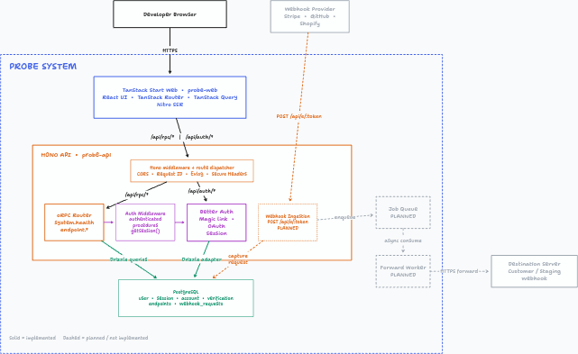

# Probe

A developer-focused webhook inspection and debugging platform. Capture, inspect, and analyze incoming HTTP requests in real time.

## Stack

- **Frontend**: TanStack Start (React 19), Vite, Tailwind CSS v4, Base UI
- **Backend**: Hono API (`@hono/node-server`)
- **API / RPC**: oRPC
- **Database**: PostgreSQL, Drizzle ORM v1 RC, drizzle-plus
- **Auth**: Better Auth 1.7 (Magic Link, OAuth)
- **Email**: React Email, Resend
- **Validation**: Zod
- **Tooling**: Turborepo, pnpm workspaces

## Architecture



[Open editable tldraw source](docs/architecture/probe-system.tldraw)

## Structure

### Apps

- `apps/web` – TanStack Start web app (marketing, auth flows, dashboard)
- `apps/api` – Hono API server (Better Auth handler, oRPC procedures)

### Packages

- `packages/api-contracts` – Shared oRPC contracts and schemas
- `packages/auth` – Better Auth configuration, client, and server utilities
- `packages/db` – Drizzle schema, PostgreSQL client, drizzle-plus extensions, migrations
- `packages/email` – React Email templates and Resend delivery client
- `packages/env` – Type-safe environment variables (`@t3-oss/env-core`, Zod)
- `packages/schemas` – Shared Zod validation schemas
- `packages/utils` – Shared utility helpers and logging
- `packages/eslint-config` – Shared ESLint configuration
- `packages/typescript-config` – Shared TypeScript configurations

## Quick Start

### 1. Environment & Database

```bash
cp .env.example .env
docker compose up -d
```

### 2. Dependencies & Schema

```bash
pnpm install
pnpm db:push
```

### 3. Start Development

```bash
pnpm dev
```

| Service | Local | Production |
| :--- | :--- | :--- |
| **Web** | http://localhost:3000 | https://probe.monobase.io.vn |
| **API** | http://localhost:3001 | https://probe-api.monobase.io.vn |
| **Email Preview** | http://localhost:3002 (`pnpm email:dev`) | — |

## Scripts

| Command | Description |
| :--- | :--- |
| `pnpm dev` | Start development servers |
| `pnpm build` | Build all apps and packages |
| `pnpm check-types` | Type-check all workspaces |
| `pnpm lint` / `pnpm format` | Lint and auto-format code |
| `pnpm db:push` | Push schema changes directly to PostgreSQL |
| `pnpm db:generate` | Generate Drizzle migrations |
| `pnpm db:migrate` | Run pending database migrations |
| `pnpm db:studio` | Open Drizzle Studio web interface |
| `pnpm email:dev` | Start React Email template preview |
